

  <a href="https://wimpys.world"><picture><source media="(prefers-color-scheme: dark)" srcset="https://raw.githubusercontent.com/flexiondotorg/flexiondotorg/ba8fa3c671e5482a7ad67f7f5ac95f067b33bd6b/hero-dark.svg"></picture></a>

  <a href="https://wimpysworld.social/@martin"><picture><source media="(prefers-color-scheme: dark)" srcset="https://raw.githubusercontent.com/flexiondotorg/flexiondotorg/ba8fa3c671e5482a7ad67f7f5ac95f067b33bd6b/nav-mastodon-dark.svg"></picture></a>
  <a href="https://bsky.app/profile/wimpys.world"><picture><source media="(prefers-color-scheme: dark)" srcset="https://raw.githubusercontent.com/flexiondotorg/flexiondotorg/ba8fa3c671e5482a7ad67f7f5ac95f067b33bd6b/nav-bluesky-dark.svg"></picture></a>
  <a href="https://www.linkedin.com/in/martinwimpress/"><picture><source media="(prefers-color-scheme: dark)" srcset="https://raw.githubusercontent.com/flexiondotorg/flexiondotorg/ba8fa3c671e5482a7ad67f7f5ac95f067b33bd6b/nav-linkedin-dark.svg"></picture></a>

Hello! I am Martin (also known as Wimpy), a long-time Linux user, open-source developer, hobbyist game developer at [Oval Tutu](https://oval-tutu.com), and a [Chainguardian](https://chainguard.dev). I co-present [Linux Matters](https://linuxmatters.sh) podcast with my friends [@popey](https://github.com/popey) and [@marxjohnson](https://github.com/marxjohnson).
I used to be the lead developer of [Ubuntu MATE](https://ubuntu-mate.org), but these days I prefer to make applications and games in my spare time. Below you will find links to some of my current projects, my first-party package repositories, and the podcast.

  <a href="https://wimpysworld.io/discord"><picture><source media="(prefers-color-scheme: dark)" srcset="https://raw.githubusercontent.com/flexiondotorg/flexiondotorg/ba8fa3c671e5482a7ad67f7f5ac95f067b33bd6b/discord-dark.svg"></picture></a>

  <a href="https://github.com/flexiondotorg"><picture><source media="(prefers-color-scheme: dark)" srcset="https://raw.githubusercontent.com/flexiondotorg/flexiondotorg/ba8fa3c671e5482a7ad67f7f5ac95f067b33bd6b/stats-dark.svg"></picture></a>

  <picture><source media="(prefers-color-scheme: dark)" srcset="https://raw.githubusercontent.com/flexiondotorg/flexiondotorg/ba8fa3c671e5482a7ad67f7f5ac95f067b33bd6b/section-projects-dark.svg"></picture>

  <a href="https://github.com/quickemu-project/quickemu"><picture><source media="(prefers-color-scheme: dark)" srcset="https://raw.githubusercontent.com/flexiondotorg/flexiondotorg/ba8fa3c671e5482a7ad67f7f5ac95f067b33bd6b/project-quickemu-dark.svg"></picture></a>
  <a href="https://github.com/wimpysworld/deb-get"><picture><source media="(prefers-color-scheme: dark)" srcset="https://raw.githubusercontent.com/flexiondotorg/flexiondotorg/ba8fa3c671e5482a7ad67f7f5ac95f067b33bd6b/project-deb-get-dark.svg"></picture></a>
  <a href="https://sidra.wimpys.world"><picture><source media="(prefers-color-scheme: dark)" srcset="https://raw.githubusercontent.com/flexiondotorg/flexiondotorg/ba8fa3c671e5482a7ad67f7f5ac95f067b33bd6b/project-sidra-dark.svg"></picture></a>
  <a href="https://github.com/wimpysworld/nix-config"><picture><source media="(prefers-color-scheme: dark)" srcset="https://raw.githubusercontent.com/flexiondotorg/flexiondotorg/ba8fa3c671e5482a7ad67f7f5ac95f067b33bd6b/project-nix-config-dark.svg"></picture></a>
  <a href="https://ia-get.wimpys.world"><picture><source media="(prefers-color-scheme: dark)" srcset="https://raw.githubusercontent.com/flexiondotorg/flexiondotorg/ba8fa3c671e5482a7ad67f7f5ac95f067b33bd6b/project-ia-get-dark.svg"></picture></a>
  <a href="https://github.com/marketplace/actions/nothing-but-nix"><picture><source media="(prefers-color-scheme: dark)" srcset="https://raw.githubusercontent.com/flexiondotorg/flexiondotorg/ba8fa3c671e5482a7ad67f7f5ac95f067b33bd6b/project-nothing-but-nix-dark.svg"></picture></a>
  <a href="https://linuxmatters.sh/jive/vocals/"><picture><source media="(prefers-color-scheme: dark)" srcset="https://raw.githubusercontent.com/flexiondotorg/flexiondotorg/ba8fa3c671e5482a7ad67f7f5ac95f067b33bd6b/project-jive-vocals-dark.svg"></picture></a>
  <a href="https://tailor.wimpys.world/"><picture><source media="(prefers-color-scheme: dark)" srcset="https://raw.githubusercontent.com/flexiondotorg/flexiondotorg/ba8fa3c671e5482a7ad67f7f5ac95f067b33bd6b/project-tailor-dark.svg"></picture></a>
  <a href="https://linuxmatters.sh/jive/visualiser/"><picture><source media="(prefers-color-scheme: dark)" srcset="https://raw.githubusercontent.com/flexiondotorg/flexiondotorg/ba8fa3c671e5482a7ad67f7f5ac95f067b33bd6b/project-jive-visualiser-dark.svg"></picture></a>
  <a href="https://linuxmatters.sh/jive/encoder/"><picture><source media="(prefers-color-scheme: dark)" srcset="https://raw.githubusercontent.com/flexiondotorg/flexiondotorg/ba8fa3c671e5482a7ad67f7f5ac95f067b33bd6b/project-jive-encoder-dark.svg"></picture></a>
  <a href="https://nyala.wimpys.world/"><picture><source media="(prefers-color-scheme: dark)" srcset="https://raw.githubusercontent.com/flexiondotorg/flexiondotorg/ba8fa3c671e5482a7ad67f7f5ac95f067b33bd6b/project-nyala-dark.svg"></picture></a>
  <a href="https://wonkey.wimpys.world/"><picture><source media="(prefers-color-scheme: dark)" srcset="https://raw.githubusercontent.com/flexiondotorg/flexiondotorg/ba8fa3c671e5482a7ad67f7f5ac95f067b33bd6b/project-wonkey-dark.svg"></picture></a>
  <a href="https://hue-jackman.wimpys.world/"><picture><source media="(prefers-color-scheme: dark)" srcset="https://raw.githubusercontent.com/flexiondotorg/flexiondotorg/ba8fa3c671e5482a7ad67f7f5ac95f067b33bd6b/project-hue-jackman-dark.svg"></picture></a>
  <a href="https://extralife.wimpys.world"><picture><source media="(prefers-color-scheme: dark)" srcset="https://raw.githubusercontent.com/flexiondotorg/flexiondotorg/ba8fa3c671e5482a7ad67f7f5ac95f067b33bd6b/project-extra-life-dark.svg"></picture></a>

  <a href="https://github.com/sponsors/flexiondotorg"><picture><source media="(prefers-color-scheme: dark)" srcset="https://raw.githubusercontent.com/flexiondotorg/flexiondotorg/ba8fa3c671e5482a7ad67f7f5ac95f067b33bd6b/sponsors-dark.svg"></picture></a>

  <picture><source media="(prefers-color-scheme: dark)" srcset="https://raw.githubusercontent.com/flexiondotorg/flexiondotorg/ba8fa3c671e5482a7ad67f7f5ac95f067b33bd6b/section-podcast-dark.svg"></picture>

<a href="https://linuxmatters.sh">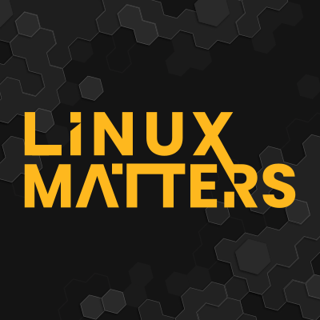</a>

- **#94** · **[A pocket full of Pi](https://linuxmatters.sh/94/)** · `35 min` (2 weeks ago)
  - Alan builds a basic build bot, Martin scopes Silo Server, and Mark clears out a collection of carefully catalogued compact computers.
- **#93** · **[Flatpak Stats vs. Snap Stats](https://linuxmatters.sh/93/)** · `42 min` (4 weeks ago)
  - Mark spies on the postman, Alan spins up yet more websites, and Martin tailors his, and, possibly your git repo.
- **#92** · **[Shonky WonKey Donkey](https://linuxmatters.sh/92/)** · `36 min` (1 month ago)
  - Martin makes some shonky software, Mark gets lightning fast 5G broadband, and Alan helps you find your next Linux machine.
- **#91** · **[Old man hands](https://linuxmatters.sh/91/)** · `35 min` (1 month ago)
  - Alan does a job switcheroo, Martin does a notes switcheroo, and Mark does a backdrop switcheroo.
- **#90** · **[Ooh, you are nøughty](https://linuxmatters.sh/90/)** · `38 min` (2 months ago)
  - Mark’s been colouring in his walls, Alan’s been reviving NøughtyLinux and Martin’s been chatting in herdr.
 

  <a href="https://geo.itunes.apple.com/podcast/feed/id1682797246"><picture><source media="(prefers-color-scheme: dark)" srcset="https://raw.githubusercontent.com/flexiondotorg/flexiondotorg/ba8fa3c671e5482a7ad67f7f5ac95f067b33bd6b/podcast-apple-podcasts-dark.svg"></picture></a>
  <a href="https://open.spotify.com/show/388W00MbvHGI69accqEHQK"><picture><source media="(prefers-color-scheme: dark)" srcset="https://raw.githubusercontent.com/flexiondotorg/flexiondotorg/ba8fa3c671e5482a7ad67f7f5ac95f067b33bd6b/podcast-spotify-dark.svg"></picture></a>
  <a href="https://www.youtube.com/@Linux-Matters"><picture><source media="(prefers-color-scheme: dark)" srcset="https://raw.githubusercontent.com/flexiondotorg/flexiondotorg/ba8fa3c671e5482a7ad67f7f5ac95f067b33bd6b/podcast-youtube-dark.svg"></picture></a>
  <a href="https://linuxmatters.sh/episode/index.xml"><picture><source media="(prefers-color-scheme: dark)" srcset="https://raw.githubusercontent.com/flexiondotorg/flexiondotorg/ba8fa3c671e5482a7ad67f7f5ac95f067b33bd6b/podcast-rss-dark.svg"></picture></a>

  <picture><source media="(prefers-color-scheme: dark)" srcset="https://raw.githubusercontent.com/flexiondotorg/flexiondotorg/ba8fa3c671e5482a7ad67f7f5ac95f067b33bd6b/section-packages-dark.svg"></picture>

  <a href="https://apt.wimpys.world"><picture><source media="(prefers-color-scheme: dark)" srcset="https://raw.githubusercontent.com/flexiondotorg/flexiondotorg/ba8fa3c671e5482a7ad67f7f5ac95f067b33bd6b/host-apt-dark.svg"></picture></a>
  <a href="https://rpm.wimpys.world"><picture><source media="(prefers-color-scheme: dark)" srcset="https://raw.githubusercontent.com/flexiondotorg/flexiondotorg/ba8fa3c671e5482a7ad67f7f5ac95f067b33bd6b/host-rpm-dark.svg"></picture></a>
  <a href="https://pkg.wimpys.world"><picture><source media="(prefers-color-scheme: dark)" srcset="https://raw.githubusercontent.com/flexiondotorg/flexiondotorg/ba8fa3c671e5482a7ad67f7f5ac95f067b33bd6b/host-pkg-dark.svg"></picture></a>
  <a href="https://apk.wimpys.world"><picture><source media="(prefers-color-scheme: dark)" srcset="https://raw.githubusercontent.com/flexiondotorg/flexiondotorg/ba8fa3c671e5482a7ad67f7f5ac95f067b33bd6b/host-apk-dark.svg"></picture></a>
  <a href="https://flatpak.wimpys.world"><picture><source media="(prefers-color-scheme: dark)" srcset="https://raw.githubusercontent.com/flexiondotorg/flexiondotorg/ba8fa3c671e5482a7ad67f7f5ac95f067b33bd6b/host-flatpak-dark.svg"></picture></a>
  <a href="https://brew.wimpys.world"><picture><source media="(prefers-color-scheme: dark)" srcset="https://raw.githubusercontent.com/flexiondotorg/flexiondotorg/ba8fa3c671e5482a7ad67f7f5ac95f067b33bd6b/host-brew-dark.svg"></picture></a>
  <a href="https://scoop.wimpys.world"><picture><source media="(prefers-color-scheme: dark)" srcset="https://raw.githubusercontent.com/flexiondotorg/flexiondotorg/ba8fa3c671e5482a7ad67f7f5ac95f067b33bd6b/host-scoop-dark.svg"></picture></a>
  <a href="https://nix.wimpys.world"><picture><source media="(prefers-color-scheme: dark)" srcset="https://raw.githubusercontent.com/flexiondotorg/flexiondotorg/ba8fa3c671e5482a7ad67f7f5ac95f067b33bd6b/host-nix-dark.svg"></picture></a>

  <picture><source media="(prefers-color-scheme: dark)" srcset="https://raw.githubusercontent.com/flexiondotorg/flexiondotorg/ba8fa3c671e5482a7ad67f7f5ac95f067b33bd6b/section-blog-dark.svg"></picture>

- **[faffing about with diffs](https://wimpysworld.com/posts/faff-ollama-conventional-commit-generator/)** · `3 min read` (1 year ago)
  - Another bloody AI commit generator, born from pure spite but stays local
- **[Nothing but Nix](https://wimpysworld.com/posts/nothing-but-nix-github-actions/)** · `7 min read` (1 year ago)
  - The Nix Space Heist: Reclaiming 130GB in GitHub Actions
- **[Fuzzel Colour Picker](https://wimpysworld.com/posts/fuzzel-hyprpicker/)** · `5 min read` (1 year ago)
  - Creating a Proper Colour Picker for Hyprland with Fuzzel
- **[Install ZeroTier on Steam Deck](https://wimpysworld.com/posts/install-zerotier-on-steamdeck/)** · `4 min read` (3 years ago)
  - How to persist software installation across SteamOS updates on the Steam Deck.
- **[Steam Box vs Steam Deck](https://wimpysworld.com/posts/steambox-vs-steamdeck/)** · `9 min read` (3 years ago)
  - I declined my Steam Deck pre-order and I’m now playing more games on Linux

Crafted with <a href="https://github.com/flexiondotorg/flexiondotorg/tree/main/cmd/vitrine">Vitrine</a>

