  <a href="https://wimpys.world"><picture><source media="(prefers-color-scheme: dark)" srcset="https://raw.githubusercontent.com/flexiondotorg/flexiondotorg/334200fd9421063068db0fce18c6f828b64cdb32/hero-dark.svg"></picture></a>

  <a href="https://wimpysworld.social/@martin"><picture><source media="(prefers-color-scheme: dark)" srcset="https://raw.githubusercontent.com/flexiondotorg/flexiondotorg/334200fd9421063068db0fce18c6f828b64cdb32/nav-mastodon-dark.svg"></picture></a>
  <a href="https://bsky.app/profile/wimpys.world"><picture><source media="(prefers-color-scheme: dark)" srcset="https://raw.githubusercontent.com/flexiondotorg/flexiondotorg/334200fd9421063068db0fce18c6f828b64cdb32/nav-bluesky-dark.svg"></picture></a>
  <a href="https://www.linkedin.com/in/martinwimpress/"><picture><source media="(prefers-color-scheme: dark)" srcset="https://raw.githubusercontent.com/flexiondotorg/flexiondotorg/334200fd9421063068db0fce18c6f828b64cdb32/nav-linkedin-dark.svg"></picture></a>

Hello! I am Martin (also known as Wimpy), a long-time Linux user, open-source developer, and community builder. I am a co-presenter of the [Linux Matters](https://linuxmatters.sh) podcast, a hobbyist game developer at [Oval Tutu](https://oval-tutu.com), and a [Chainguardian](https://chainguard.dev).
I used to be the lead developer of [Ubuntu MATE](https://ubuntu-mate.org), but these days I prefer to make applications and games in my spare time. Below you will find links to some of my current projects, my first-party package repositories, and the podcast.

  <a href="https://wimpysworld.io/discord"><picture><source media="(prefers-color-scheme: dark)" srcset="https://raw.githubusercontent.com/flexiondotorg/flexiondotorg/334200fd9421063068db0fce18c6f828b64cdb32/discord-dark.svg"></picture></a>

  <a href="https://github.com/flexiondotorg"><picture><source media="(prefers-color-scheme: dark)" srcset="https://raw.githubusercontent.com/flexiondotorg/flexiondotorg/334200fd9421063068db0fce18c6f828b64cdb32/stats-dark.svg"></picture></a>

Enjoy my work? <a href="https://github.com/sponsors/flexiondotorg">Sponsor on GitHub</a>

Past sponsors: fredre, jmelahman, da-moon, mmartial, castrojo, roryrjb, sonwh98, casmokey, the-shank, ipkpjersi, AlbanDAVID, Simmonz, CreeperLKF, v-nils, gthelding, edgeform, user8446

  <picture><source media="(prefers-color-scheme: dark)" srcset="https://raw.githubusercontent.com/flexiondotorg/flexiondotorg/334200fd9421063068db0fce18c6f828b64cdb32/section-projects-dark.svg"></picture>

  <a href="https://sidra.wimpys.world"><picture><source media="(prefers-color-scheme: dark)" srcset="https://raw.githubusercontent.com/flexiondotorg/flexiondotorg/334200fd9421063068db0fce18c6f828b64cdb32/project-sidra-dark.svg"></picture></a>
  <a href="https://github.com/wimpysworld/nix-config"><picture><source media="(prefers-color-scheme: dark)" srcset="https://raw.githubusercontent.com/flexiondotorg/flexiondotorg/334200fd9421063068db0fce18c6f828b64cdb32/project-nix-config-dark.svg"></picture></a>
  <a href="https://ia-get.wimpys.world"><picture><source media="(prefers-color-scheme: dark)" srcset="https://raw.githubusercontent.com/flexiondotorg/flexiondotorg/334200fd9421063068db0fce18c6f828b64cdb32/project-ia-get-dark.svg"></picture></a>
  <a href="https://github.com/marketplace/actions/nothing-but-nix"><picture><source media="(prefers-color-scheme: dark)" srcset="https://raw.githubusercontent.com/flexiondotorg/flexiondotorg/334200fd9421063068db0fce18c6f828b64cdb32/project-nothing-but-nix-dark.svg"></picture></a>
  <a href="https://linuxmatters.sh/jive/vocals/"><picture><source media="(prefers-color-scheme: dark)" srcset="https://raw.githubusercontent.com/flexiondotorg/flexiondotorg/334200fd9421063068db0fce18c6f828b64cdb32/project-jive-vocals-dark.svg"></picture></a>
  <a href="https://tailor.wimpys.world/"><picture><source media="(prefers-color-scheme: dark)" srcset="https://raw.githubusercontent.com/flexiondotorg/flexiondotorg/334200fd9421063068db0fce18c6f828b64cdb32/project-tailor-dark.svg"></picture></a>
  <a href="https://linuxmatters.sh/jive/visualiser/"><picture><source media="(prefers-color-scheme: dark)" srcset="https://raw.githubusercontent.com/flexiondotorg/flexiondotorg/334200fd9421063068db0fce18c6f828b64cdb32/project-jive-visualiser-dark.svg"></picture></a>
  <a href="https://linuxmatters.sh/jive/encoder/"><picture><source media="(prefers-color-scheme: dark)" srcset="https://raw.githubusercontent.com/flexiondotorg/flexiondotorg/334200fd9421063068db0fce18c6f828b64cdb32/project-jive-encoder-dark.svg"></picture></a>
  <a href="https://nyala.wimpys.world/"><picture><source media="(prefers-color-scheme: dark)" srcset="https://raw.githubusercontent.com/flexiondotorg/flexiondotorg/334200fd9421063068db0fce18c6f828b64cdb32/project-nyala-dark.svg"></picture></a>
  <a href="https://wonkey.wimpys.world/"><picture><source media="(prefers-color-scheme: dark)" srcset="https://raw.githubusercontent.com/flexiondotorg/flexiondotorg/334200fd9421063068db0fce18c6f828b64cdb32/project-wonkey-dark.svg"></picture></a>
  <a href="https://hue-jackman.wimpys.world/"><picture><source media="(prefers-color-scheme: dark)" srcset="https://raw.githubusercontent.com/flexiondotorg/flexiondotorg/334200fd9421063068db0fce18c6f828b64cdb32/project-hue-jackman-dark.svg"></picture></a>
  <a href="https://extralife.wimpys.world"><picture><source media="(prefers-color-scheme: dark)" srcset="https://raw.githubusercontent.com/flexiondotorg/flexiondotorg/334200fd9421063068db0fce18c6f828b64cdb32/project-extra-life-dark.svg"></picture></a>

  <picture><source media="(prefers-color-scheme: dark)" srcset="https://raw.githubusercontent.com/flexiondotorg/flexiondotorg/334200fd9421063068db0fce18c6f828b64cdb32/section-podcast-dark.svg"></picture>

- **#94** · **[A pocket full of Pi](https://linuxmatters.sh/94/)** · `35 min` (1 week ago)
  - Alan builds a basic build bot, Martin scopes Silo Server, and Mark clears out a collection of carefully catalogued compact computers.
- **#93** · **[Flatpak Stats vs. Snap Stats](https://linuxmatters.sh/93/)** · `42 min` (3 weeks ago)
  - Mark spies on the postman, Alan spins up yet more websites, and Martin tailors his, and, possibly your git repo.
- **#92** · **[Shonky WonKey Donkey](https://linuxmatters.sh/92/)** · `36 min` (1 month ago)
  - Martin makes some shonky software, Mark gets lightning fast 5G broadband, and Alan helps you find your next Linux machine.
- **#91** · **[Old man hands](https://linuxmatters.sh/91/)** · `35 min` (1 month ago)
  - Alan does a job switcheroo, Martin does a notes switcheroo, and Mark does a backdrop switcheroo.
- **#90** · **[Ooh, you are nøughty](https://linuxmatters.sh/90/)** · `38 min` (2 months ago)
  - Mark’s been colouring in his walls, Alan’s been reviving NøughtyLinux and Martin’s been chatting in herdr.
 

  <picture><source media="(prefers-color-scheme: dark)" srcset="https://raw.githubusercontent.com/flexiondotorg/flexiondotorg/334200fd9421063068db0fce18c6f828b64cdb32/section-packages-dark.svg"></picture>

  <a href="https://apt.wimpys.world"><picture><source media="(prefers-color-scheme: dark)" srcset="https://raw.githubusercontent.com/flexiondotorg/flexiondotorg/334200fd9421063068db0fce18c6f828b64cdb32/host-apt-dark.svg"></picture></a>
  <a href="https://rpm.wimpys.world"><picture><source media="(prefers-color-scheme: dark)" srcset="https://raw.githubusercontent.com/flexiondotorg/flexiondotorg/334200fd9421063068db0fce18c6f828b64cdb32/host-rpm-dark.svg"></picture></a>
  <a href="https://pkg.wimpys.world"><picture><source media="(prefers-color-scheme: dark)" srcset="https://raw.githubusercontent.com/flexiondotorg/flexiondotorg/334200fd9421063068db0fce18c6f828b64cdb32/host-pkg-dark.svg"></picture></a>
  <a href="https://apk.wimpys.world"><picture><source media="(prefers-color-scheme: dark)" srcset="https://raw.githubusercontent.com/flexiondotorg/flexiondotorg/334200fd9421063068db0fce18c6f828b64cdb32/host-apk-dark.svg"></picture></a>
  <a href="https://flatpak.wimpys.world"><picture><source media="(prefers-color-scheme: dark)" srcset="https://raw.githubusercontent.com/flexiondotorg/flexiondotorg/334200fd9421063068db0fce18c6f828b64cdb32/host-flatpak-dark.svg"></picture></a>
  <a href="https://brew.wimpys.world"><picture><source media="(prefers-color-scheme: dark)" srcset="https://raw.githubusercontent.com/flexiondotorg/flexiondotorg/334200fd9421063068db0fce18c6f828b64cdb32/host-brew-dark.svg"></picture></a>
  <a href="https://scoop.wimpys.world"><picture><source media="(prefers-color-scheme: dark)" srcset="https://raw.githubusercontent.com/flexiondotorg/flexiondotorg/334200fd9421063068db0fce18c6f828b64cdb32/host-scoop-dark.svg"></picture></a>
  <a href="https://nix.wimpys.world"><picture><source media="(prefers-color-scheme: dark)" srcset="https://raw.githubusercontent.com/flexiondotorg/flexiondotorg/334200fd9421063068db0fce18c6f828b64cdb32/host-nix-dark.svg"></picture></a>

  <picture><source media="(prefers-color-scheme: dark)" srcset="https://raw.githubusercontent.com/flexiondotorg/flexiondotorg/334200fd9421063068db0fce18c6f828b64cdb32/section-contributions-dark.svg"></picture>

- [**snapcrafters/discord**](https://github.com/snapcrafters/discord) (today) - A community-maintained package to easily install Discord on Linux
- [**NixOS/nixpkgs**](https://github.com/NixOS/nixpkgs) (today) - Nix Packages collection & NixOS
- [**mate-desktop/mate-desktop.org**](https://github.com/mate-desktop/mate-desktop.org) (6 days ago) - mate-desktop.org website
- [**hajimehoshi/ebiten**](https://github.com/hajimehoshi/ebiten) (2 weeks ago) - A dead simple 2D game engine for Go
- [**snapcrafters/obs-studio**](https://github.com/snapcrafters/obs-studio) (3 weeks ago) - This is a community-supported modified build of OBS Studio.

  <picture><source media="(prefers-color-scheme: dark)" srcset="https://raw.githubusercontent.com/flexiondotorg/flexiondotorg/334200fd9421063068db0fce18c6f828b64cdb32/section-releases-dark.svg"></picture>

- [**wimpysworld/nyala**](https://github.com/wimpysworld/nyala) ([`v0.2.1`](https://github.com/wimpysworld/nyala/releases/tag/v0.2.1), today) - A browser for the terminal 🦌
- [**wimpysworld/hue-jackman**](https://github.com/wimpysworld/hue-jackman) ([`v0.1.0`](https://github.com/wimpysworld/hue-jackman/releases/tag/v0.1.0), today) - Razer Wolverine V2 Chroma RGB control for Linux. Hijack the hues, bub 🎮
- [**wimpysworld/nix-config**](https://github.com/wimpysworld/nix-config) ([`v26.5.20261113`](https://github.com/wimpysworld/nix-config/releases/tag/v26.5.20261113), 6 days ago) - Wimpy's NixOS, nix-darwin  & Home Manager Configurations ❄️
- [**wimpysworld/ia-get**](https://github.com/wimpysworld/ia-get) ([`0.2.0`](https://github.com/wimpysworld/ia-get/releases/tag/0.2.0), 1 week ago) - File downloader for archive.org ⬇️
- [**wimpysworld/tailor**](https://github.com/wimpysworld/tailor) ([`v0.6.6`](https://github.com/wimpysworld/tailor/releases/tag/v0.6.6), 1 week ago) - Ready-to-wear project templates for GitHub repositories 👔

  <picture><source media="(prefers-color-scheme: dark)" srcset="https://raw.githubusercontent.com/flexiondotorg/flexiondotorg/334200fd9421063068db0fce18c6f828b64cdb32/section-starred-dark.svg"></picture>

- [**moltis-org/moltis**](https://github.com/moltis-org/moltis) · `★ 2,986` - A secure persistent personal agent server in Rust. One binary, sandboxed execution, multi-provider LLMs, voice, memory, Telegram, WhatsApp, Discord, Teams, and MCP tools. Secure by design, runs on your hardware.
- [**fencesandbox/fence**](https://github.com/fencesandbox/fence) · `★ 1,024` - Lightweight, container-free sandbox for running commands with network and filesystem restrictions
- [**hajimehoshi/ebiten**](https://github.com/hajimehoshi/ebiten) · `★ 13,647` - A dead simple 2D game engine for Go
- [**powerfooI/roamgate**](https://github.com/powerfooI/roamgate) · `★ 329` - A Herdr client for any screen. Control terminals, monitor coding agents, and review files and diffs from desktop or mobile.
- [**Fovty/HushMic**](https://github.com/Fovty/HushMic) · `★ 284` - Real-time microphone noise suppression for Linux as a system-wide virtual mic (DPDFNet + PipeWire).

  <picture><source media="(prefers-color-scheme: dark)" srcset="https://raw.githubusercontent.com/flexiondotorg/flexiondotorg/334200fd9421063068db0fce18c6f828b64cdb32/section-blog-dark.svg"></picture>

- **[faffing about with diffs](https://wimpysworld.com/posts/faff-ollama-conventional-commit-generator/)** · `3 min read` (1 year ago)
  - Another bloody AI commit generator, born from pure spite but stays local
- **[Nothing but Nix](https://wimpysworld.com/posts/nothing-but-nix-github-actions/)** · `7 min read` (1 year ago)
  - The Nix Space Heist: Reclaiming 130GB in GitHub Actions
- **[Fuzzel Colour Picker](https://wimpysworld.com/posts/fuzzel-hyprpicker/)** · `5 min read` (1 year ago)
  - Creating a Proper Colour Picker for Hyprland with Fuzzel
- **[Install ZeroTier on Steam Deck](https://wimpysworld.com/posts/install-zerotier-on-steamdeck/)** · `4 min read` (3 years ago)
  - How to persist software installation across SteamOS updates on the Steam Deck.
- **[Steam Box vs Steam Deck](https://wimpysworld.com/posts/steambox-vs-steamdeck/)** · `9 min read` (3 years ago)
  - I declined my Steam Deck pre-order and I’m now playing more games on Linux

Crafted with <a href="https://github.com/flexiondotorg/flexiondotorg/tree/main/cmd/vitrine">Vitrine</a>

